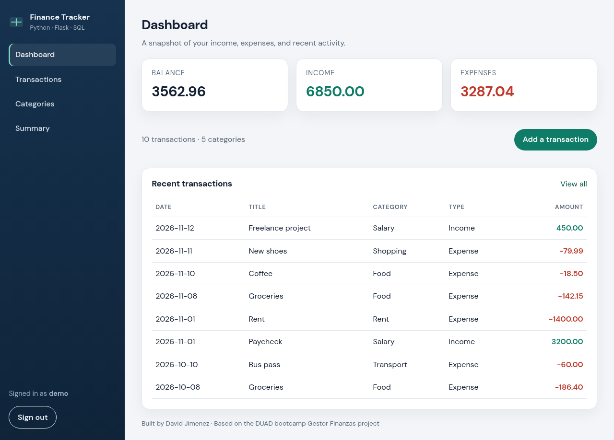
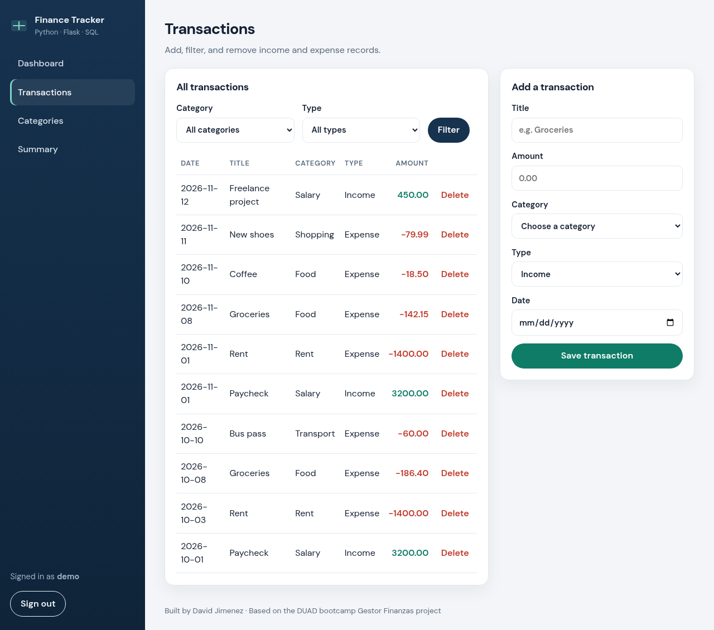
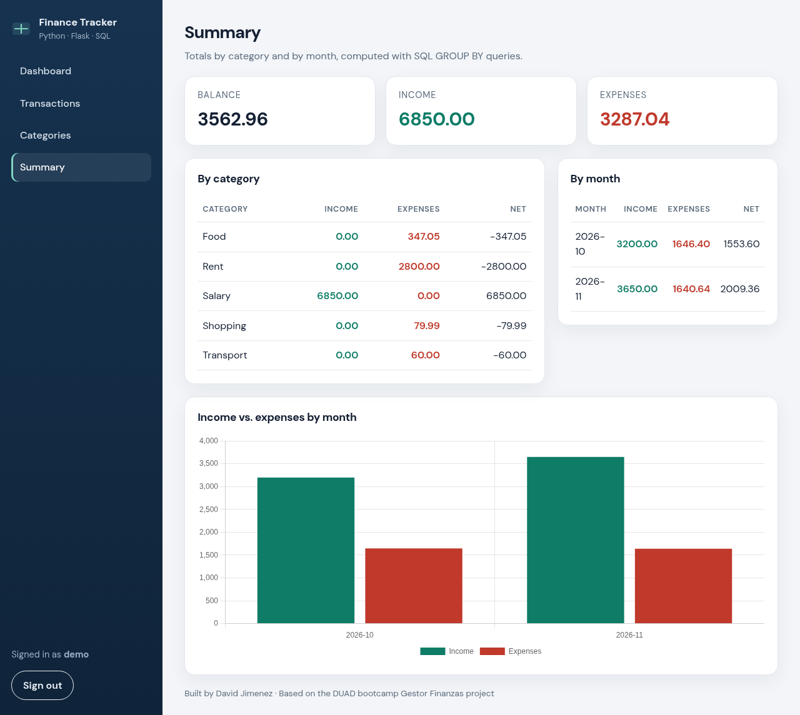

# Finance Tracker

A small personal-finance web app built with **Python, Flask, SQLite, HTML, and CSS**. Create an account, add categories, record income and expenses, and view totals on a dashboard and a monthly/category summary.

This project is based on my DUAD bootcamp **Gestor Finanzas** project, originally a desktop app with in-memory logic and JSON persistence. This version keeps that domain model (categories, signed income/expense amounts, and the same totals/balance rules) and turns it into a multi-user web app with a SQLite database, login, and tests.

Built by [David Jimenez](https://github.com/coderblockch) as a portfolio piece for junior Python, SQL, and web development roles.

## Features

- Register, sign in, and sign out with hashed passwords and session-based auth
- Protected pages (dashboard, transactions, categories, summary)
- Dashboard with balance, income vs. expense totals, and recent transactions
- Add and delete transactions, and filter the list by category or type
- Add categories (unique per user)
- Summary tables by category and by month, plus an optional Chart.js bar chart
- SQLite schema with `users`, `categories`, and `transactions` (foreign keys included)
- CLI commands to create tables and seed demo data
- 19 pytest tests covering the original finance logic, authentication, and adding a transaction

## Tech stack

- Python 3.11+
- Flask 3 and Flask-SQLAlchemy
- SQLite
- Jinja2 templates and custom CSS
- Werkzeug password hashing
- Chart.js (CDN) for the optional summary chart
- Pytest
- Gunicorn for production (Render)

## Screenshots

**Dashboard**: balance, income vs. expenses, and recent transactions



**Transactions**: list, filters, and the add form



**Summary**: totals by category and by month, with a Chart.js chart



*Screenshots taken from a local run with the `seed-db` demo data.*

## Local setup

```bash
git clone https://github.com/coderblockch/finance-tracker-flask.git
cd finance-tracker-flask
python3 -m venv .venv
source .venv/bin/activate   # Windows: .venv\Scripts\activate
pip install -r requirements.txt
flask --app app init-db
flask --app app seed-db     # optional; creates user demo / demodemo
flask --app app run
```

Open [http://127.0.0.1:5000](http://127.0.0.1:5000). If you skipped the seed command, register a new account from the sign-in page.

Set `SECRET_KEY` in your environment for anything other than local development. The app falls back to `"dev"` when that variable is unset.

## Running tests

```bash
pytest
# 19 passed
```

The test suite uses a temporary SQLite database and the Flask test client. It includes the original Gestor Finanzas logic tests plus authentication and transaction tests.

## Project structure

```text
finance-tracker-flask/
├── app/
│   ├── __init__.py          # Application factory, init-db and seed-db CLI
│   ├── auth.py              # Register, login, logout, login_required
│   ├── db.py                # SQLAlchemy instance
│   ├── logic.py             # Domain logic ported from Gestor Finanzas
│   ├── main.py              # Dashboard, transactions, categories, summary
│   ├── models.py            # User, Category, and Transaction models
│   ├── static/style.css
│   └── templates/
│       ├── base.html
│       ├── auth/
│       ├── dashboard.html
│       ├── transactions.html
│       ├── categories.html
│       └── summary.html
├── tests/
│   ├── conftest.py
│   ├── test_logic.py
│   ├── test_auth.py
│   └── test_transactions.py
├── docs/screenshots/
├── requirements.txt
├── render.yaml
├── Procfile
├── LICENSE
└── README.md
```

## Deploy

**GitHub Pages cannot host this app.** GitHub Pages only serves static files (HTML, CSS, and JavaScript). Flask is a server-side Python application, so it needs a host that can run Python, such as [Render](https://render.com).

### Deploy on Render

1. Push this repository to GitHub.
2. In Render, create a new **Web Service** and connect the repo. A `render.yaml` blueprint is included, so you can also use **New > Blueprint**.
3. Render will install dependencies from `requirements.txt` and start the app with Gunicorn:

   ```text
   gunicorn --bind 0.0.0.0:$PORT "app:create_app()"
   ```

4. Set a strong `SECRET_KEY` environment variable (the blueprint can generate one). Do not use the local `"dev"` default in production.

Tables are created automatically on startup, so you do not need to run `flask --app app init-db` on Render. You can optionally run `flask --app app seed-db` in a Render shell if you want the demo user (`demo` / `demodemo`).

**SQLite limitation:** on Render's free plan the database lives on an ephemeral disk. It is wiped when the service sleeps, restarts, or redeploys, so you may need to register again after a reset. For lasting data, switch `DATABASE_URL` to a managed Postgres database (a persistent disk is not available on the free plan).

A `Procfile` is included as well for platforms that look for one.

## License

This project is released under the [MIT License](LICENSE). Copyright (c) 2026 David Jimenez.
